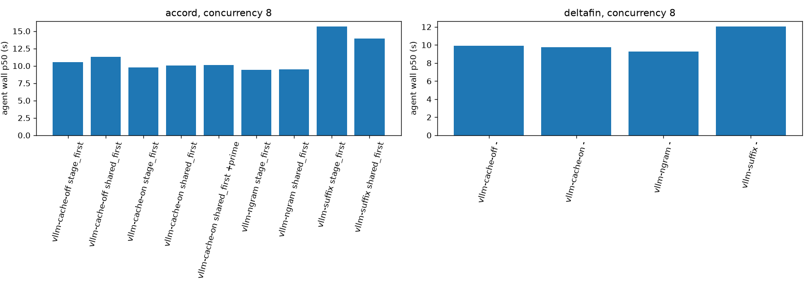

# Results

Deltas compare each run with the same engine's cache-off config on the same trace, concurrency and structured-output arm; negative is faster. `wave-0` calls are the first requests of a session (for Accord, the parallel stage calls). `prime` is the shared-prefix request sent before wave 0; it is inside the agent wall time. `out tok/session` and `out tok/wave-0 call` are mean generated tokens: compare latency only between runs where they match (the structured-off arm does not). `cache hit` and `spec accept` are `-` where the engine exposes no usable counter.

## rtx4060

### accord

| config | layout | conc | structured | wave-0 TTFT p50 ms | wave-0 TTFT p95 ms | agent wall p50 s | agent wall p95 s | out tok/s | out tok/session | out tok/wave-0 call | cache hit | spec accept | prime p50 ms | errors | Δ wave-0 TTFT p50 | Δ wall p50 |
|---|---|---|---|---|---|---|---|---|---|---|---|---|---|---|---|---|
| vllm-cache-off | shared_first | 1 | on | 202 | 264 | 8.35 | 11.36 | 116 | 998 | 303 | - | - | - | 0 | +0% | +0% |
| vllm-cache-off | shared_first | 8 | on | 279 | 1614 | 11.27 | 14.06 | 557 | 992 | 300 | - | - | - | 0 | +0% | +0% |
| vllm-cache-off | stage_first | 1 | on | 194 | 298 | 7.64 | 9.44 | 114 | 923 | 277 | - | - | - | 0 | +0% | +0% |
| vllm-cache-off | stage_first | 8 | on | 294 | 1590 | 10.51 | 12.73 | 551 | 930 | 280 | - | - | - | 0 | +0% | +0% |
| vllm-cache-on | shared_first | 1 | on | 133 | 168 | 8.59 | 11.88 | 113 | 995 | 300 | 41.9% | - | - | 0 | -34% | +3% |
| vllm-cache-on | shared_first | 8 | on | 180 | 949 | 10.03 | 13.14 | 610 | 996 | 302 | 41.9% | - | - | 0 | -35% | -11% |
| vllm-cache-on | shared_first | 1 | off | 139 | 166 | 6.52 | 14.81 | 109 | 737 | 212 | 41.9% | - | - | 0 | - | - |
| vllm-cache-on | shared_first | 8 | off | 173 | 950 | 6.89 | 17.49 | 489 | 735 | 213 | 41.9% | - | - | 0 | - | - |
| vllm-cache-on | shared_first +prime | 1 | on | 102 | 108 | 8.34 | 11.26 | 114 | 996 | 300 | 49.9% | - | 65 | 0 | -49% | -0% |
| vllm-cache-on | shared_first +prime | 8 | on | 157 | 551 | 10.15 | 13.48 | 611 | 996 | 301 | 49.9% | - | 116 | 0 | -44% | -10% |
| vllm-cache-on | stage_first | 1 | on | 137 | 242 | 7.63 | 10.21 | 113 | 934 | 280 | 34.0% | - | - | 0 | -30% | -0% |
| vllm-cache-on | stage_first | 8 | on | 202 | 1100 | 9.75 | 11.70 | 578 | 933 | 279 | 34.0% | - | - | 0 | -31% | -7% |
| vllm-cache-on | stage_first | 1 | off | 140 | 235 | 3.84 | 5.28 | 98 | 367 | 96 | 34.0% | - | - | 0 | - | - |
| vllm-cache-on | stage_first | 8 | off | 196 | 1062 | 5.36 | 6.80 | 520 | 387 | 100 | 34.0% | - | - | 0 | - | - |
| vllm-ngram | shared_first | 1 | on | 129 | 159 | 5.71 | 6.62 | 176 | 994 | 302 | 41.9% | 24.5% | - | 0 | -36% | -32% |
| vllm-ngram | shared_first | 8 | on | 165 | 987 | 9.48 | 11.74 | 723 | 1010 | 305 | 41.9% | 24.1% | - | 0 | -41% | -16% |
| vllm-ngram | stage_first | 1 | on | 128 | 244 | 5.83 | 6.88 | 156 | 935 | 280 | 34.0% | 21.1% | - | 0 | -34% | -24% |
| vllm-ngram | stage_first | 8 | on | 190 | 1109 | 9.42 | 11.32 | 657 | 933 | 280 | 34.0% | 20.8% | - | 0 | -36% | -10% |
| vllm-suffix | shared_first | 1 | on | 198 | 617 | 8.83 | 14.50 | 110 | 1016 | 308 | 41.9% | 54.1% | - | 0 | -2% | +6% |
| vllm-suffix | shared_first | 8 | on | 397 | 1555 | 13.92 | 17.94 | 481 | 1004 | 304 | 41.9% | 53.4% | - | 0 | +42% | +24% |
| vllm-suffix | stage_first | 1 | on | 218 | 555 | 8.14 | 12.78 | 105 | 930 | 278 | 34.0% | 48.8% | - | 0 | +12% | +7% |
| vllm-suffix | stage_first | 8 | on | 465 | 1725 | 15.68 | 18.21 | 424 | 935 | 281 | 34.0% | 48.4% | - | 0 | +58% | +49% |

#### accord: output agreement

| config | conc | comparison | sessions | identical sessions | categorical agreement | numeric mean abs diff | unparsed |
|---|---|---|---|---|---|---|---|
| vllm-cache-off | 1 | shared_first vs stage_first | 20 | 0% | 49.7% | 0.073 | 0 |
| vllm-cache-off | 8 | shared_first vs stage_first | 20 | 0% | 54.1% | 0.089 | 0 |
| vllm-cache-on | 1 | shared_first vs stage_first | 20 | 0% | 56.0% | 0.070 | 0 |
| vllm-cache-on | 8 | shared_first vs stage_first | 20 | 0% | 53.3% | 0.077 | 0 |
| vllm-cache-on | 1 | shared_first +prime vs stage_first | 20 | 0% | 53.8% | 0.070 | 0 |
| vllm-cache-on | 8 | shared_first +prime vs stage_first | 20 | 0% | 53.3% | 0.078 | 0 |
| vllm-ngram | 1 | shared_first vs stage_first | 20 | 0% | 56.9% | 0.074 | 0 |
| vllm-ngram | 1 | accord-shared_first vs vllm-cache-on | 20 | 0% | 85.6% | 0.005 | 0 |
| vllm-ngram | 8 | shared_first vs stage_first | 20 | 0% | 54.2% | 0.093 | 0 |
| vllm-ngram | 8 | accord-shared_first vs vllm-cache-on | 20 | 0% | 88.8% | 0.007 | 0 |
| vllm-ngram | 1 | accord-stage_first vs vllm-cache-on | 20 | 10% | 90.2% | 0.016 | 0 |
| vllm-ngram | 8 | accord-stage_first vs vllm-cache-on | 20 | 0% | 87.7% | 0.030 | 0 |
| vllm-suffix | 1 | shared_first vs stage_first | 20 | 0% | 54.3% | 0.081 | 0 |
| vllm-suffix | 1 | accord-shared_first vs vllm-cache-on | 20 | 0% | 83.2% | 0.007 | 0 |
| vllm-suffix | 8 | shared_first vs stage_first | 20 | 0% | 51.6% | 0.091 | 0 |
| vllm-suffix | 8 | accord-shared_first vs vllm-cache-on | 20 | 0% | 87.9% | 0.003 | 0 |
| vllm-suffix | 1 | accord-stage_first vs vllm-cache-on | 20 | 0% | 88.6% | 0.032 | 0 |
| vllm-suffix | 8 | accord-stage_first vs vllm-cache-on | 20 | 0% | 84.9% | 0.027 | 0 |
| vllm-cache-off | 1 vs 8 | accord-stage_first vs itself (noise floor) | 20 | 0% | 83.9% | 0.032 | 0 |
| vllm-cache-on | 1 vs 8 | accord-stage_first vs itself (noise floor) | 20 | 0% | 88.1% | 0.024 | 0 |
| vllm-ngram | 1 vs 8 | accord-stage_first vs itself (noise floor) | 20 | 5% | 88.7% | 0.034 | 0 |
| vllm-suffix | 1 vs 8 | accord-stage_first vs itself (noise floor) | 20 | 0% | 85.1% | 0.032 | 0 |

### deltafin

| config | layout | conc | structured | wave-0 TTFT p50 ms | wave-0 TTFT p95 ms | agent wall p50 s | agent wall p95 s | out tok/s | out tok/session | out tok/wave-0 call | cache hit | spec accept | prime p50 ms | errors | Δ wave-0 TTFT p50 | Δ wall p50 |
|---|---|---|---|---|---|---|---|---|---|---|---|---|---|---|---|---|
| vllm-cache-off | - | 1 | on | 88 | 114 | 8.25 | 12.17 | 70 | 588 | 176 | - | - | - | 0 | +0% | +0% |
| vllm-cache-off | - | 8 | on | 300 | 544 | 9.90 | 12.48 | 284 | 583 | 169 | - | - | - | 0 | +0% | +0% |
| vllm-cache-on | - | 1 | on | 74 | 117 | 8.14 | 12.00 | 69 | 598 | 178 | 17.9% | - | - | 0 | -16% | -1% |
| vllm-cache-on | - | 8 | on | 303 | 452 | 9.73 | 12.89 | 296 | 594 | 179 | 17.9% | - | - | 0 | +1% | -2% |
| vllm-ngram | - | 1 | on | 69 | 92 | 6.71 | 10.01 | 82 | 584 | 177 | 17.9% | 8.1% | - | 0 | -22% | -19% |
| vllm-ngram | - | 8 | on | 307 | 460 | 9.29 | 12.59 | 330 | 588 | 181 | 17.9% | 8.2% | - | 0 | +2% | -6% |
| vllm-suffix | - | 1 | on | 84 | 162 | 11.70 | 18.17 | 49 | 591 | 182 | 17.9% | 42.2% | - | 0 | -4% | +42% |
| vllm-suffix | - | 8 | on | 356 | 519 | 12.05 | 16.80 | 268 | 567 | 175 | 17.9% | 41.9% | - | 0 | +19% | +22% |

#### deltafin: output agreement

| config | conc | comparison | sessions | identical sessions | categorical agreement | numeric mean abs diff | unparsed |
|---|---|---|---|---|---|---|---|
| vllm-ngram | 1 | deltafin vs vllm-cache-on | 10 | 0% | - | - | 0 |
| vllm-ngram | 8 | deltafin vs vllm-cache-on | 10 | 0% | - | - | 0 |
| vllm-suffix | 1 | deltafin vs vllm-cache-on | 10 | 0% | - | - | 0 |
| vllm-suffix | 8 | deltafin vs vllm-cache-on | 10 | 0% | - | - | 0 |
| vllm-cache-off | 1 vs 8 | deltafin vs itself (noise floor) | 10 | 10% | - | - | 0 |
| vllm-cache-on | 1 vs 8 | deltafin vs itself (noise floor) | 10 | 0% | - | - | 0 |
| vllm-ngram | 1 vs 8 | deltafin vs itself (noise floor) | 10 | 0% | - | - | 0 |
| vllm-suffix | 1 vs 8 | deltafin vs itself (noise floor) | 10 | 0% | - | - | 0 |
